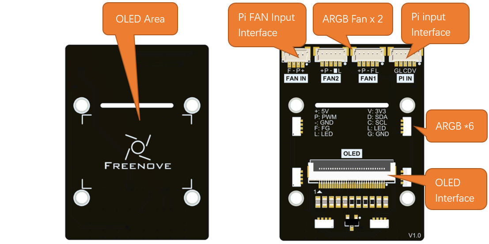

##############################################################################
Chapter 1 Control Board
##############################################################################

In this chapter, we will introduce the functions of the control board.

1.1 Introduction to Control Board
*******************************************

This control board is equipped with multiple interfaces and features 6 built-in ARGB LEDs that can synchronize with ARGB fan lighting:

* Pi FAN Input Interface: RPi 5 fan control interface, controlling fan speed and providing speed feedback.

* ARGB FAN: Two channels of ARGB FAN (Note: FAN2 interface does not have speed feedback)

* Pi input Interface: Raspberry Pi IIC communication and LED control interface.

* OLED Interface: Connect to 0.96 inch OLED Screen, IIC communication protocol