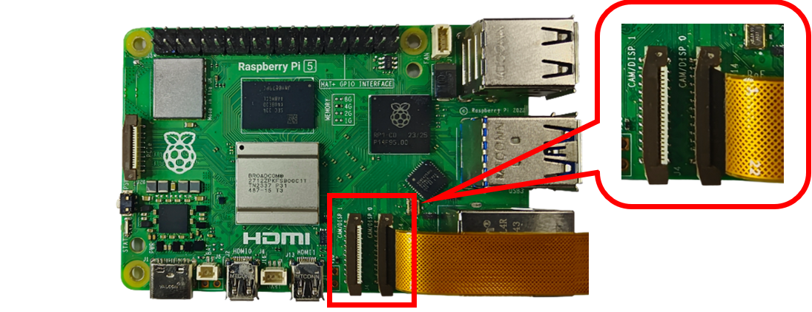
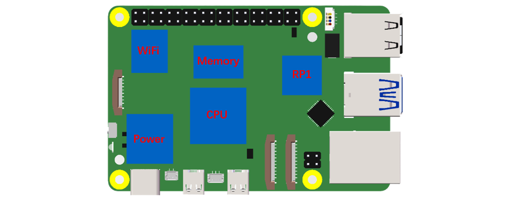
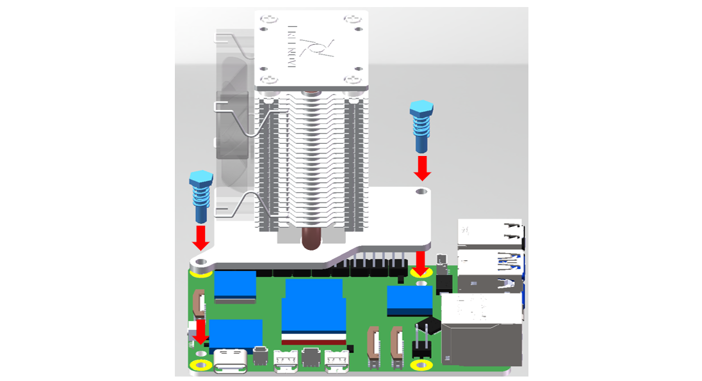
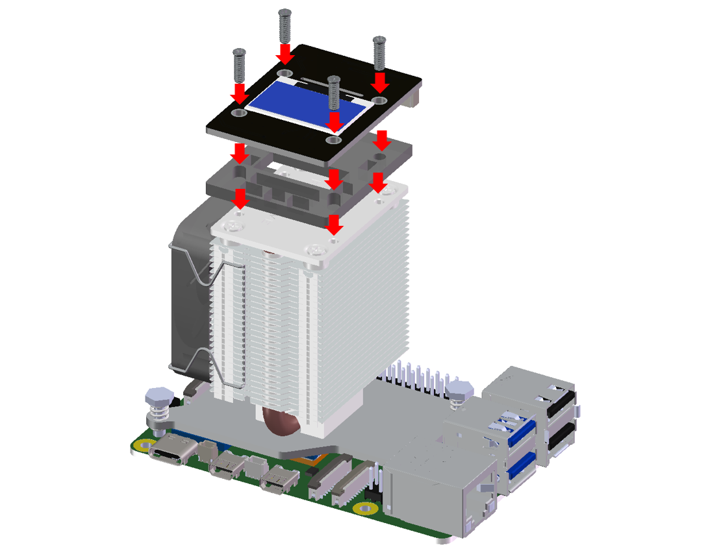
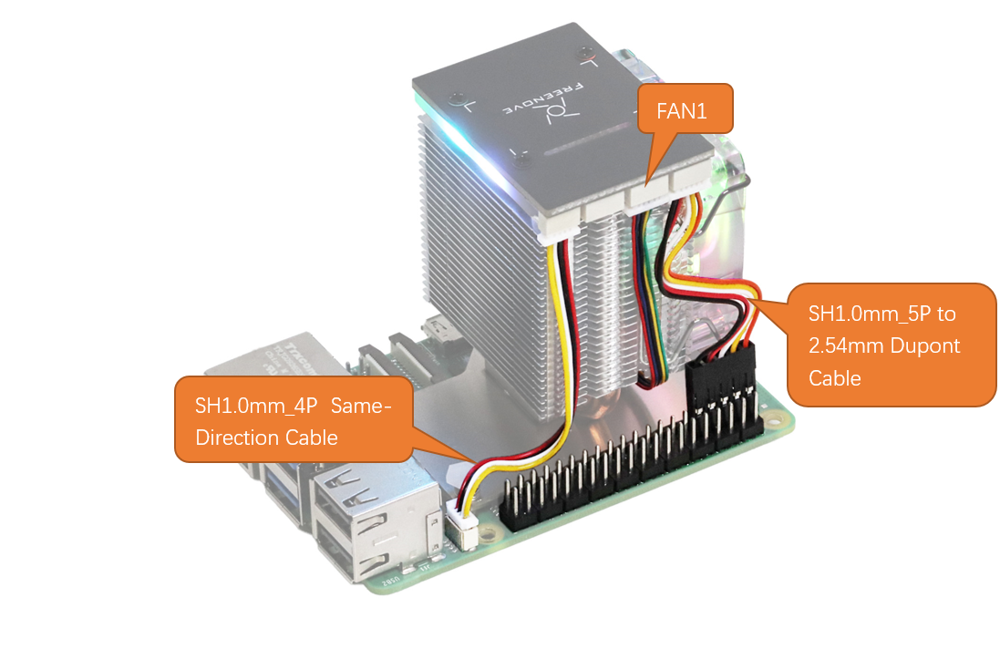
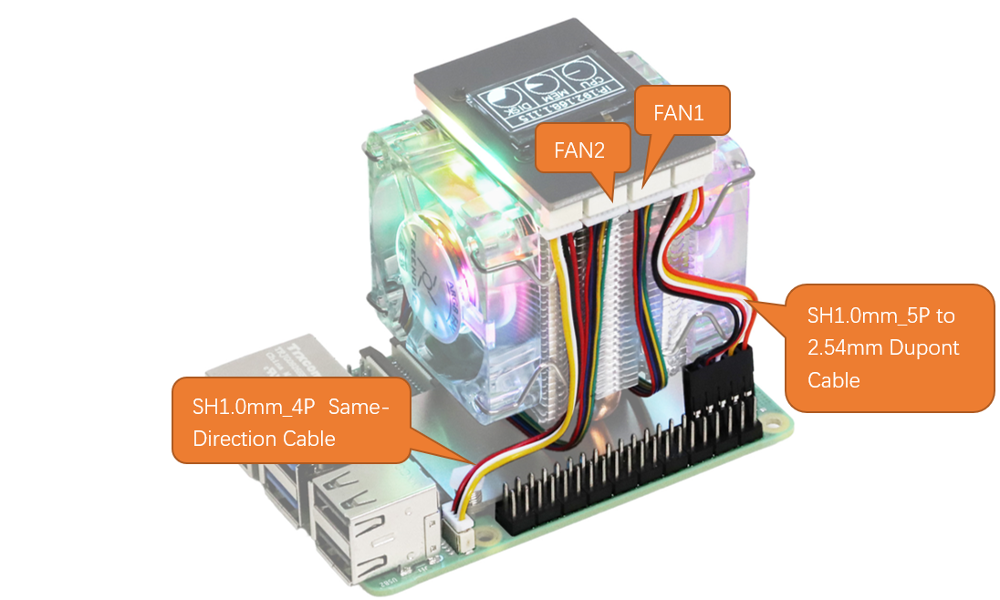

##############################################################################
Chapter 2 Assembly
##############################################################################

It is recommended to assemble and use the Freenove Tower Cooler for Raspberry Pi according to this tutorial. Otherwise, it may lead to incorrect device installation or damage. As noted earlier, please check the part list. If any component is missing from your kit, do not start assembly; instead, please email our support team at support@freenove.com to get the missing parts.

**Make sure the device is powered off before assembly.**

2.1 Assemble the Tower Cooler
************************************

.. table::
    :align: center
    :class: table-line
    
    +---------------------------------------------------------------------------------------------------------------------------------------------------------------------------------------------------------------------------------------------------------------------------+
    | :red:`Note: The installation of a tower cooler may make it difficult to access the CAM/DISP interface. if you need to connect a device (such as a camera) to this interface, you must connect the cable before installing the cooler. Otherwise, you may skip this step.` |
    |                                                                                                                                                                                                                                                                           |
    | |Chapter2_00|                                                                                                                                                                                                                                                             |
    +---------------------------------------------------------------------------------------------------------------------------------------------------------------------------------------------------------------------------------------------------------------------------+
    | Step 1: Identify the five thermal pads by size and apply each one to its corresponding chip on the RPi 5. (:red:`Important: Remove the protective film from both sides of each thermal pad to ensure optimal thermal conductivity.`)                                      |
    |                                                                                                                                                                                                                                                                           |
    | |Chapter2_01|                                                                                                                                                                                                                                                             |
    +---------------------------------------------------------------------------------------------------------------------------------------------------------------------------------------------------------------------------------------------------------------------------+
    | Step 2: Fix the Tower Cooler to RPi 5 with the Nylon standoffs.                                                                                                                                                                                                           |
    |                                                                                                                                                                                                                                                                           |
    | |Chapter2_02|                                                                                                                                                                                                                                                             |
    +---------------------------------------------------------------------------------------------------------------------------------------------------------------------------------------------------------------------------------------------------------------------------+
    | Step 3: Align the acrylic with the Control Board and secure it to the top of the RPi using M2.5*8 screws.                                                                                                                                                                 |
    |                                                                                                                                                                                                                                                                           |
    | |Chapter2_03|                                                                                                                                                                                                                                                             |
    +---------------------------------------------------------------------------------------------------------------------------------------------------------------------------------------------------------------------------------------------------------------------------+
    | Step 4:                                                                                                                                                                                                                                                                   |
    |                                                                                                                                                                                                                                                                           |
    | :red:`Notice: This connector is polarized (non-reversible). Forcing it or connecting it incorrectly will permanently damage the interface.`                                                                                                                               |
    |                                                                                                                                                                                                                                                                           |
    | If you purchased FNK0113A, please wire according to the diagram below.                                                                                                                                                                                                    |
    |                                                                                                                                                                                                                                                                           |
    | |Chapter2_04|                                                                                                                                                                                                                                                             |
    |                                                                                                                                                                                                                                                                           |
    | If you purchased FNK0113B, please wire according to the diagram below.                                                                                                                                                                                                    |
    |                                                                                                                                                                                                                                                                           |
    | |Chapter2_05|                                                                                                                                                                                                                                                             |
    +---------------------------------------------------------------------------------------------------------------------------------------------------------------------------------------------------------------------------------------------------------------------------+

