##############################################################################
Chapter 3 APP Control
##############################################################################

Before powering on the Freenove Tower Cooler for Raspberry Pi, please make sure that all cable connections are correct.

:red:`This case requires an adequate power supply. We highly recommend using the official Raspberry Pi 5.1V / 5A power adapter` (https://www.raspberrypi.com/products/27w-power-supply`).

:red:`Failure to do so may result in the Freenove Tower Cooler for Raspberry Pi being unusable or causing damage to components.`

3.1 Boot Behavior & Environment Settings
**********************************************

3.1.1 What to Expect on First Startup
============================================

After installation is complete, please follow the steps below to confirm all functions are working properly.

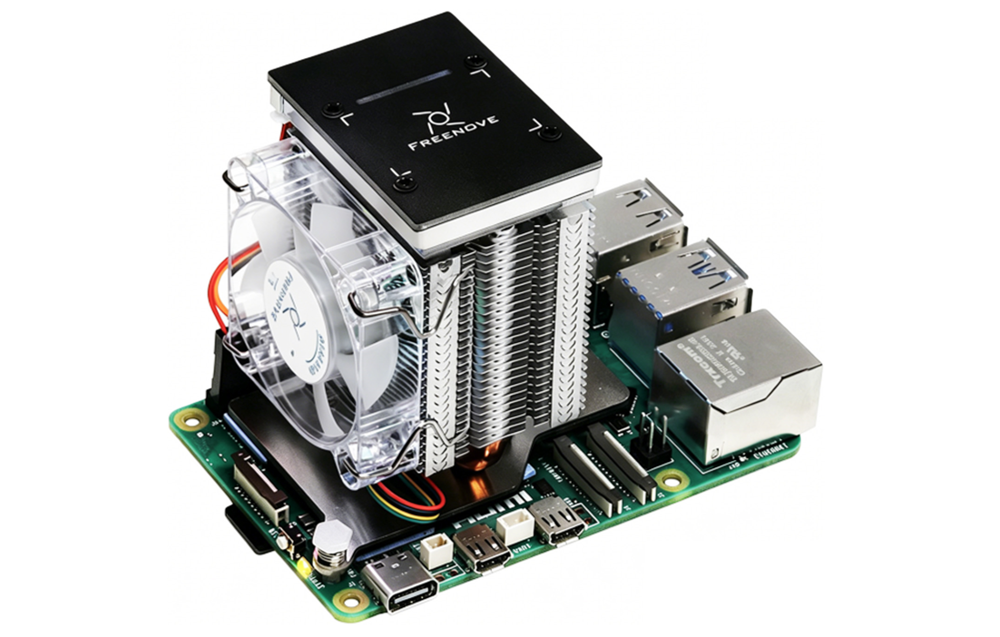

1. When the RPi starts up, the fan should automatically spin twice, indicating the fan is running normally.

**Troubleshooting Guide:**

If the fan does not spin at startup, please: Immediately power off the system, and check if the SH1.0mm_4P Same-Direction Cable and SH1.0mm_5P to 2.54mm Dupont Cable are connected correctly.

:red:`If you have any questions of the above, please contact us at support@freenove.com`

2. RPi 5 Status LED: The green STAT LED will remain steadily illuminated. If this LED is not lit or displays any pattern other than a steady green light, it indicates that the Raspberry Pi operating system has not booted successfully. In this case, please check your Raspberry Pi hardware and OS installation separately.

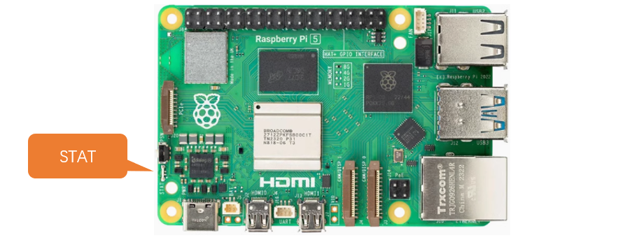

In this case, you can connect a screen to your Raspberry Pi or access it via VNC viewer. 

:red:`If you have any questions of the above, please contact us at support@freenove.com`

3.1.2 Software Setup
============================================

Software Packages Update
-----------------------------------------

Run the following command on the terminal to update your Raspberry Pi's package list to the latest version.

In the latest Raspberry Pi 13 (Trixie), passwordless sudo is officially disabled. You will need to enter your user password every time you run a sudo command. Please enter your user password when prompted. (Note: The default password is "raspberry", please replace it with your user password.)

.. code-block:: console
    
    sudo apt update

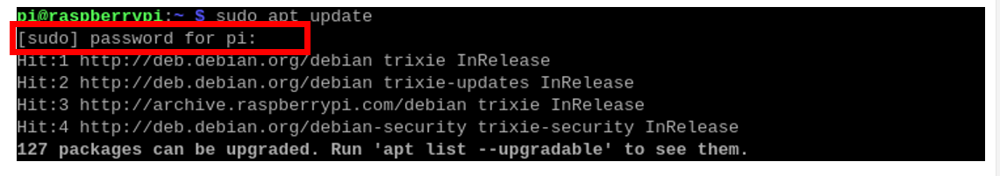

Code downloading
-----------------------------------------

Open the Raspberry Pi Terminal, type the following two commands one by one to download the code.

.. code-block:: console
    
    cd
    git clone https://github.com/Freenove/Freenove_Tower_Cooler_for_Raspberry_Pi.git

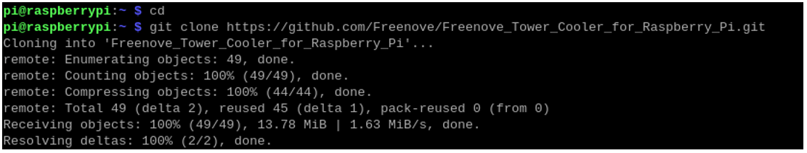

Enable I2C (Important)
-----------------------------------------

The I2C function must be enabled, as it is required for communication between the Raspberry Pi, the OLED display. Without it, the chassis software will fail to operate.

Run the following command to open the Raspberry Pi configuration interface.

.. code-block:: console
    
    sudo raspi-config

Navigate to Interface Options and press Enter. 

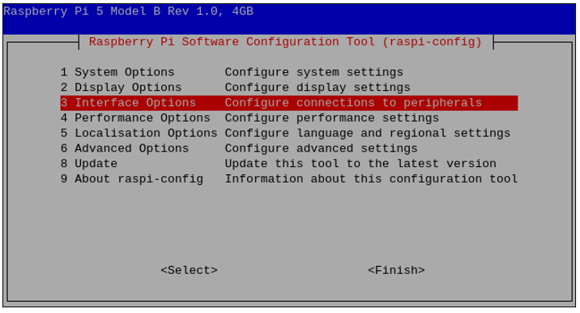

Select I2C and press Enter to enable it.

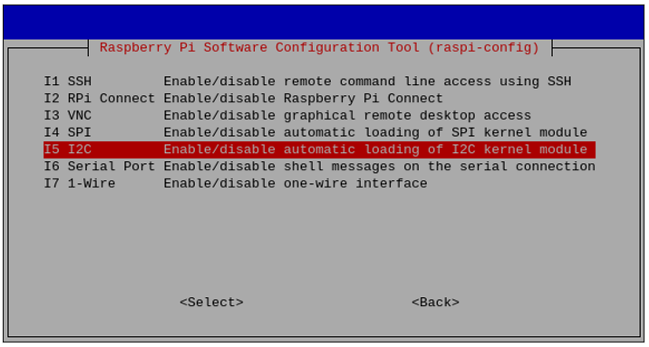

Select Yes, and press Enter.

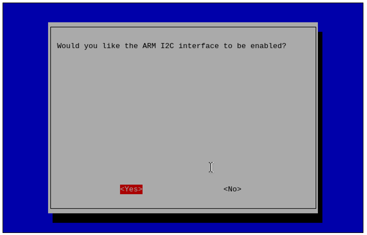

Select Finish to save the change and exit the configuration interface.

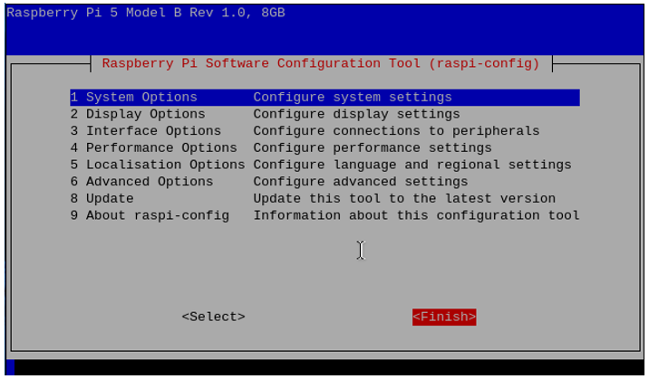

Creating Desktop Shortcut 
--------------------------------------

Run the following two commands one by one in the Raspberry Pi terminal to create a desktop shortcut for the case control software. Configuring the software environment takes some time, please be patient.

.. code-block:: console
    
    cd Freenove_Tower_Cooler_for_Raspberry_Pi
    sudo python setup.py

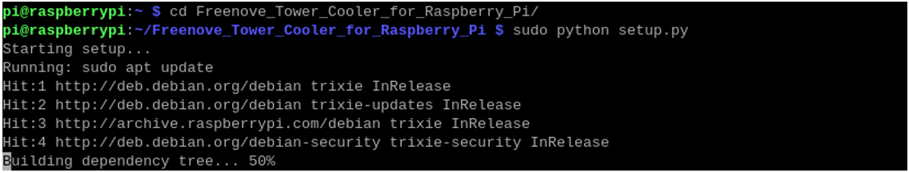

When configuring the environment, you need to select the corresponding product. Please enter "2" to download the code for the corresponding product.

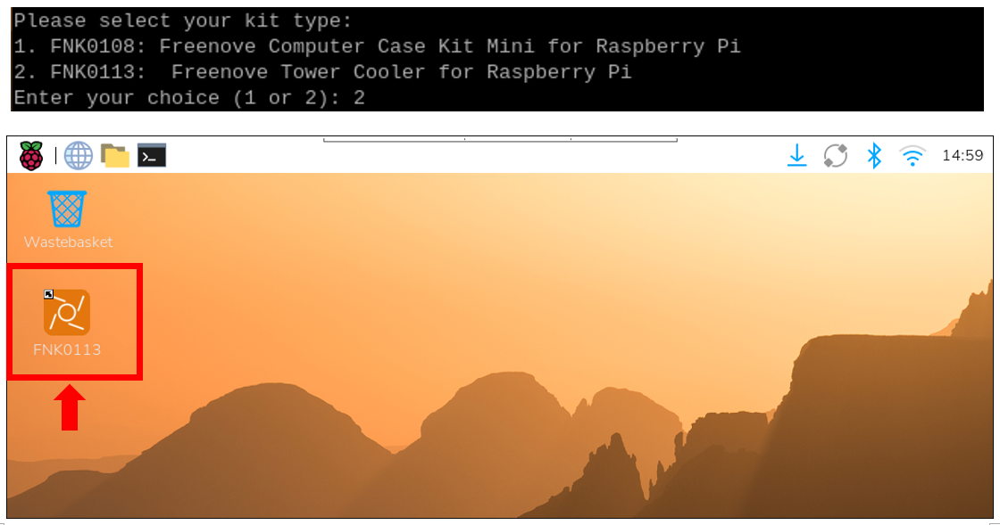

The icon above is a shortcut for the following command.

.. code-block:: console
    
    cd Freenove_Tower_Cooler_for_Raspberry_Pi/Code/
    python app_ui.py

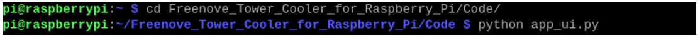

After completing this step, you will find the application in the "**Programming**" section of the menu. If you accidentally delete the desktop shortcut or wish to add the app to the top launcher, simply right-click "**FNK0113**" and select "**Add to Desktop**"or "**Add to Launcher**".

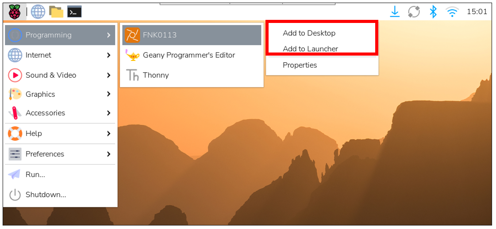

:combo:`red font-bolder:If you are interested in the code implementation, you can explore the files in the Freenove_Tower_Cooler_for_Raspberry_Pi/Code directory.`

:combo:`red font-bolder:Should you wish to modify the code, please ensure you back it up first to avoid potential software malfunctions caused by unintended changes.`

Double click the software with Freenove logo on RPi's desktop, and a window will pop up. Click "Execute" to run the program.

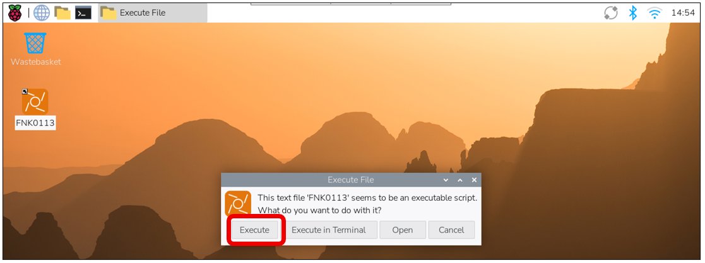

Since passwordless sudo is disabled in Trixie, you will also be asked for your password again after reboot. Enter your user password in the pop-up terminal window.

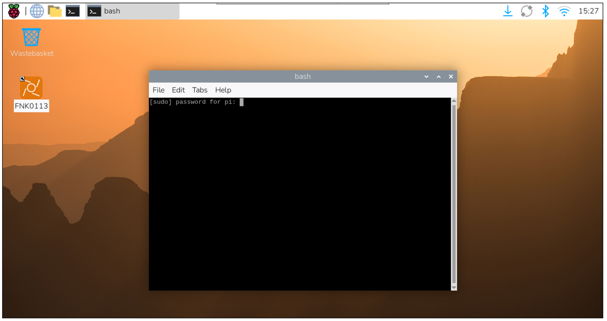

The software interface is shown below. The left window is the main software interface, and the right window displays debugging information.

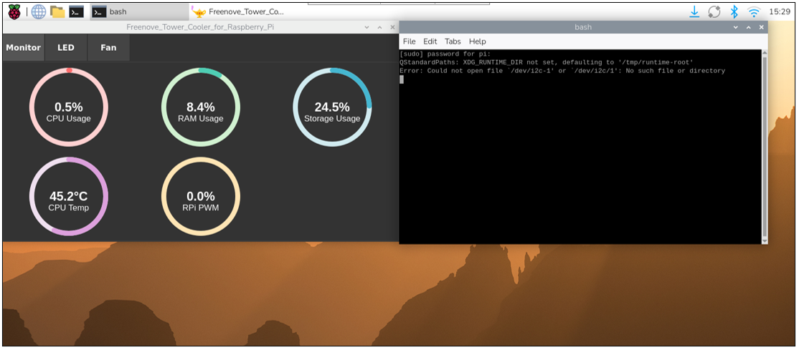