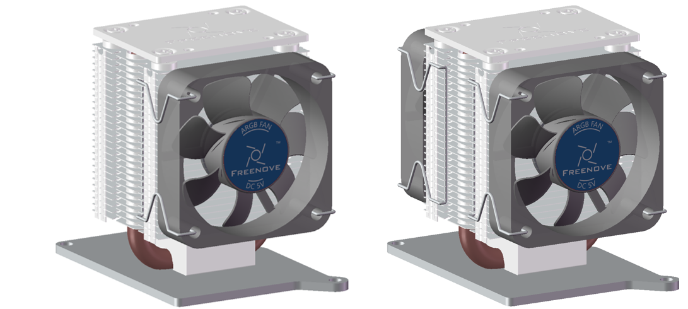
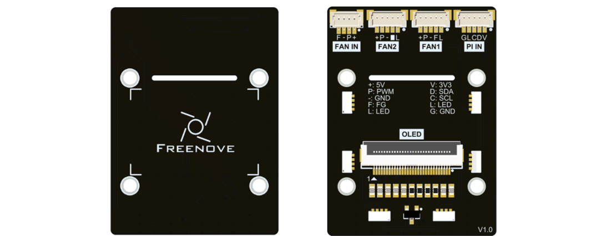
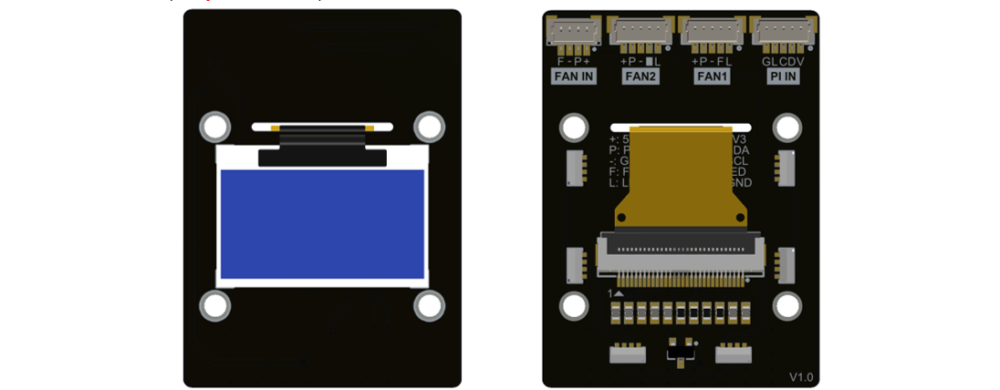
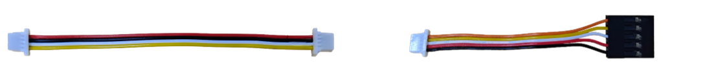
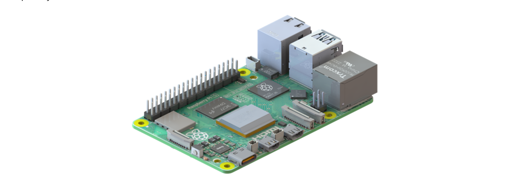

##############################################################################
List
##############################################################################

Before getting started, please check the part list. If any component is missing from your kit, do not start assembly; instead, please email our support team at support@freenove.com to get the missing parts.

Metal Parts
**************************

.. table::
    :align: center
    :class: table-line
    
    +-----------------------------------------------------------------------------------------+
    | Single-fan Tower Cooler x1 (:red:`left`) or Dual-fan Tower Cooler x1 (:red:`right`)     |
    |                                                                                         |
    | |List00|                                                                                |
    +-----------------------------------------------------------------------------------------+
    | Thermal Pad x5, Nylon Standoff x2                                                       |
    |                                                                                         |
    | |List01|                                                                                |
    +-----------------------------------------------------------------------------------------+

Acrylic Parts
**************************

:combo:`red font-bolder:Note: Please peel off the protective films from the acrylic parts before use.`

.. table::
    :align: center
    :class: table-line
    
    +------------+
    | Acrylic x1 |
    |            |
    | |List02|   |
    +------------+

Machinery Parts
**************************

.. table::
    :align: center
    :class: table-line
    
    +------------+
    | |List03|   |
    +------------+

Electronic Parts
**************************

Control Board
===========================

.. table::
    :align: center
    :class: table-line
    
    +----------------------------------------+
    | Control Board x1                       |
    |                                        |
    | |List04|                               |
    +----------------------------------------+
    | Control Board x1(:red:`Only FNK0113B`) |
    |                                        |
    | |List05|                               |
    +----------------------------------------+

Wires
**************************

.. table::
    :align: center
    :class: table-line
    
    +------------------------------------------+
    | SH1.0mm_4P Same-Direction Cable 8cm x1   |
    |                                          |
    | SH1.0mm_5P to 2.54mm Dupont Cable 7cm x1 |
    |                                          |
    | |List06|                                 |
    +------------------------------------------+

Tools
**************************

.. table::
    :align: center
    :class: table-line
    
    +------------------------------------------+
    | Cross screwdriver (3mm) x 1              |
    |                                          |
    | |List07|                                 |
    +------------------------------------------+

Required but NOT Contained Parts
****************************************************

.. table::
    :align: center
    :class: table-line
    
    +----------------------------------------------------------------------------------------------------------------------+
    | Raspberry Pi 5 x 1                                                                                                   |
    |                                                                                                                      |
    | |List08|                                                                                                             |
    +----------------------------------------------------------------------------------------------------------------------+
    | 27W Power Adapter x 1(:red:`or a power adapter compatible with Raspberry Pi official one that can output 5.1V/5A`)   |
    |                                                                                                                      |
    | |List09|                                                                                                             |
    +----------------------------------------------------------------------------------------------------------------------+
    | Micro SD Card (TF Card), Card Reader x 1                                                                             |
    |                                                                                                                      |
    | |List10|                                                                                                             |
    +----------------------------------------------------------------------------------------------------------------------+

Before getting started, please check the part list. If any component is missing from your kit, do not start assembly; instead, please email our support team at support@freenove.com to get the missing parts.