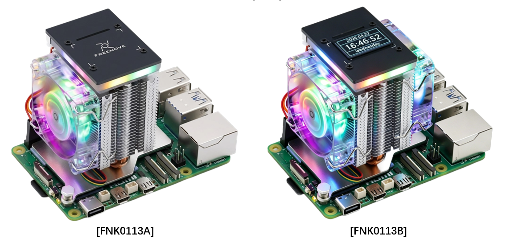

##############################################################################
Preface
##############################################################################

**Welcome to use the Freenove Tower Cooler for Raspberry Pi**

This product is exclusively designed for the RPi 5, a popular single-board computer (SBC). Follow this tutorial, you can provide better heat dissipation performance for your RPi 5.

The RPi 5 delivers highly powerful performance with a CPU frequency of up to 2.4GHz. However, this increased power consumption also leads to significant heat generation. Without an appropriate heatsink, thermal throttling may severely limit the Raspberry Pi 5's performance.

In this context, our case kit came into being. It's able to provide perfect heat dissipation capability for your RPi 5, allowing your RPi 5 to deliver more powerful and stable performance.

If you encounter any issues, feel free to contact us for prompt and free technical support.

support@freenove.com